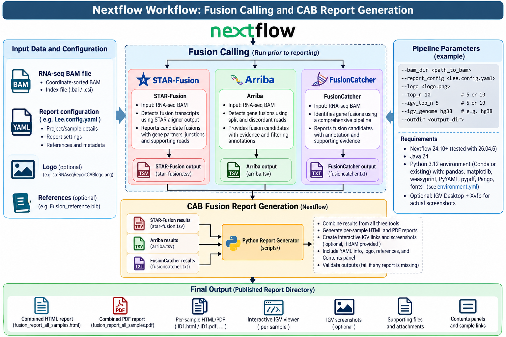

<a id="top"></a>


# Nextflow Workflow: Fusion Calling and CAB Report Generation

**Documentation:** Introduction, workflow architecture, environment setup, input organization, execution, and quality control.

## Table of Contents

1. [Introduction](#introduction)
2. [Objectives](#objectives)
3. [Overall workflow](#overall-workflow)
4. [Pipeline architecture](#pipeline-architecture)
5. [Environment Setup — Software requirements](#environment-setup--software-requirements)
6. [Input files and directory organization](#input-files-and-directory-organization)
7. [Pipeline Execution instructions](#pipeline-execution-instructions)
8. [Quality control and validation](#quality-control-and-validation)

---

## Introduction

Gene fusions are important molecular alterations in cancer that arise from chromosomal rearrangements, genomic deletions, inversions, or complex structural events. These alterations can contribute to tumor initiation, disease progression, therapeutic resistance, and the development of distinct molecular subtypes. Accurate identification and characterization of fusion transcripts from RNA sequencing (RNA-seq) data are therefore essential for cancer genomics research, molecular classification, and the discovery of potentially actionable biomarkers.

The **Nextflow Fusion Calling and CAB Report Generation Pipeline** is an automated, modular, and reproducible bioinformatics workflow designed to identify, annotate, integrate, and visualize candidate gene fusions from RNA-seq data.

The workflow integrates three established fusion detection tools:

- **STAR-Fusion:** Identifies fusion transcripts using chimeric alignments and supporting RNA-seq reads.
- **Arriba:** Detects gene fusions using split reads, discordant read pairs, and annotation-based filtering.
- **FusionCatcher:** Identifies potential fusion transcripts using multiple alignment and fusion-detection strategies.

By integrating results from these complementary algorithms, the pipeline facilitates comprehensive fusion discovery, cross-tool comparison, and prioritization of candidate fusion events.

Following fusion detection, a Python-based reporting module consolidates the tool-specific outputs and generates standardized **CAB (Computational Biology and Bioinformatics)** fusion reports in HTML and PDF formats. Reports provide candidate summaries, supporting evidence, genomic annotations, sample-specific results, and interactive links for reviewing candidate fusions in **Integrative Genomics Viewer (IGV)**.

The workflow uses **Nextflow** for reproducible execution, scalable computation, and organized output publication in Linux and high-performance computing (HPC) environments.

[↑ Back to Table of Contents](#table-of-contents)

---

## Objectives

The primary objectives of the pipeline are to:

1. Automate fusion identification using STAR-Fusion, Arriba, and FusionCatcher.
2. Support standardized processing of RNA-seq BAM files.
3. Integrate candidate gene fusions identified by multiple algorithms.
4. Provide a consistent framework for evaluating fusion candidates and their supporting evidence.
5. Generate publication-ready and research-oriented HTML/PDF fusion reports.
6. Facilitate visual inspection through IGV hyperlinks and optional alignment screenshots.
7. Improve reproducibility, traceability, and scalability of fusion analysis.

[↑ Back to Table of Contents](#table-of-contents)

---

## Overall workflow


The pipeline consists of three major stages:

**Stage 1 — Input preparation and fusion calling.** STAR-Fusion, Arriba, and FusionCatcher are used to identify candidate fusions, each producing its own results and supporting evidence. Their execution requirements may differ; for example, an existing BAM alone may not satisfy all three callers' standard input requirements.

**Stage 2 — Fusion result integration and report generation.** Results from all three tools are collected, parsed, standardized, and incorporated into sample-specific and cohort-level summaries by the CAB Python reporting module.

**Stage 3 — Report publication and visualization.** The workflow publishes consolidated HTML/PDF reports, per-sample reports, IGV links, optional screenshots, and accompanying supporting files.

**Important distinction:** The CAB reporting stage consumes *precomputed* `star-fusion.tsv`, `arriba.tsv`, and `fusioncatcher.txt` files for every sample. These files **must already be present in the report input directory** when report generation begins.

[↑ Back to Table of Contents](#table-of-contents)

---

## Pipeline architecture

| Component | Purpose | Expected report input / output |
|---|---|---|
| STAR-Fusion | Detect fusion transcripts from RNA-seq alignment evidence | `star-fusion.tsv` |
| Arriba | Identify and filter candidate fusion events | `arriba.tsv` |
| FusionCatcher | Identify candidate fusions using complementary methods | `fusioncatcher.txt` |
| CAB Python Report Generator | Standardize and combine results into reports | HTML and PDF reports |
| IGV integration | Provide alignment visualization | IGV links and optional screenshots |
| Nextflow | Coordinate execution and publish outputs | Execution logs and published reports |

The filenames above are the **standardized names expected as inputs to the CAB report**. Original tool output filenames may differ and should be renamed or transformed as required by the reporting workflow.

[↑ Back to Table of Contents](#table-of-contents)

---

## Environment Setup — Software requirements

| Software | Version / requirement | Function |
|---|---|---|
| Nextflow | 24.10+; diagram indicates testing with 26.04.6 | Workflow orchestration |
| Java | 24 according to the supplied diagram | Nextflow runtime |
| Python | 3.12 | CAB report generation |
| pandas | Compatible version | Data processing and tables |
| matplotlib | Compatible version | Plots |
| PyYAML | Compatible version | YAML configuration parsing |
| WeasyPrint | Compatible version | PDF rendering |
| pypdf | Compatible version | PDF processing |
| Pillow | Compatible version | Image processing |
| IGV Desktop | Optional | BAM alignment visualization |
| Xvfb | Optional | Headless IGV screenshots on HPC |

### Create the report environment

Install dependencies from the provided `environment.yml`:

```bash
conda env create -f environment.yml
conda activate cab-fusion-reports
```

> The `conda activate` command assumes the `name:` field in `environment.yml` is `cab-fusion-reports`; if it differs, activate the environment specified in the file.

Check software versions:

```bash
nextflow -version
java -version
python --version
```

Fusion callers additionally require their respective software installations, compatible reference databases, and tool-specific alignment resources. The report environment alone does not necessarily install the three upstream callers.

[↑ Back to Table of Contents](#table-of-contents)

---

## Input files and directory organization

**For every sample, the reporting input folder must contain all three fusion results:**

- `star-fusion.tsv` (**required**)
- `arriba.tsv` (**required**)
- `fusioncatcher.txt` (**required**)

BAM files may be placed **either alongside these results in the input directory or in a separate BAM directory**. Corresponding BAM indexes must be available for indexed visualization.

### Input requirements

| Input | Requirement | Location |
|---|---|---|
| `star-fusion.tsv` | Required for report generation | Sample folder within input directory |
| `arriba.tsv` | Required for report generation | Sample folder within input directory |
| `fusioncatcher.txt` | Required for report generation | Sample folder within input directory |
| `Sample_ID.bam` | Required for BAM-dependent IGV functions | Sample input folder **or** separate BAM directory |
| `Sample_ID.bam.bai` or `.csi` | Required for indexed BAM visualization | Alongside its BAM |
| `Lee.config.yaml` | Required | User-specified configuration path |
| `logo.png` | Optional | User-specified path |
| Fusion reference bibliography | Optional | User-specified path |

### Option 1 — Fusion results and BAM files together

```text
Fusion_Project/
├── input/
│   ├── Sample_01/
│   │   ├── star-fusion.tsv
│   │   ├── arriba.tsv
│   │   ├── fusioncatcher.txt
│   │   ├── Sample_01.bam
│   │   └── Sample_01.bam.bai
│   └── Sample_02/
│       ├── star-fusion.tsv
│       ├── arriba.tsv
│       ├── fusioncatcher.txt
│       ├── Sample_02.bam
│       └── Sample_02.bam.bai
├── Lee.config.yaml
└── results/
```

### Option 2 — Fusion results and BAM files in separate directories

```text
Fusion_Project/
├── input/
│   ├── Sample_01/
│   │   ├── star-fusion.tsv
│   │   ├── arriba.tsv
│   │   └── fusioncatcher.txt
│   └── Sample_02/
│       ├── star-fusion.tsv
│       ├── arriba.tsv
│       └── fusioncatcher.txt
├── bam/
│   ├── Sample_01.bam
│   ├── Sample_01.bam.bai
│   ├── Sample_02.bam
│   └── Sample_02.bam.bai
├── Lee.config.yaml
└── results/
```

**Sample matching:** Use consistent sample identifiers between fusion result folders and BAM files so the reporting module can associate fusion candidates with the correct alignments.

[↑ Back to Table of Contents](#table-of-contents)

---

## Pipeline Execution instructions

Run commands from the project directory containing `main.nf`, or provide the correct path to the Nextflow script. Before reporting, confirm all three fusion-result files exist for each sample.

### Option 1 — BAM files and fusion results together

```bash
nextflow run main.nf \
  --input_dir /path/to/input \
  --bam_dir /path/to/input \
  --report_config Lee.config.yaml \
  --outdir fusion_reports \
  -resume
```

### Option 2 — BAM files in a separate directory

```bash
nextflow run main.nf \
  --input_dir /path/to/input \
  --bam_dir /path/to/bam \
  --report_config Lee.config.yaml \
  --top_n 10 \
  --igv_top_n 5 \
  --igv_genome hg38 \
  --outdir fusion_reports \
  -resume
```

> **Parameter verification required:** `--input_dir` was proposed in the supplied documentation; its actual availability and name must be verified in `main.nf`/`nextflow.config`. The example commands have not been tested against the pipeline source code.

### Parameter reference

| Parameter | Purpose | Example |
|---|---|---|
| `--input_dir` | Directory with per-sample fusion-calling results; **verify parameter name in source** | `/path/to/input` |
| `--bam_dir` | Location of BAM files | `/path/to/bam` |
| `--report_config` | Report YAML configuration file | `Lee.config.yaml` |
| `--logo` | Optional report logo | `logo.png` |
| `--top_n` | Number of leading fusion candidates highlighted | `10` |
| `--igv_top_n` | Number of candidates for IGV visualization | `5` |
| `--igv_genome` | IGV genome assembly | `hg38` |
| `--outdir` | Published report directory | `fusion_reports` |
| `-resume` | Reuse compatible completed Nextflow tasks | Flag |

### Expected report outputs

The report stage is designed to produce:

- Combined report: `fusion_report_all_samples.html` and `fusion_report_all_samples.pdf`.
- Per-sample HTML and PDF reports.
- Interactive IGV links and optionally screenshots.
- Supporting files, attachments, and navigational content panels.

Actual published folder structure and file names depend on the pipeline implementation.

### HPC execution

Where a Slurm profile is configured in the Nextflow configuration, execution may use `-profile slurm`:

```bash
nextflow run main.nf \
  -profile slurm \
  --input_dir /path/to/input \
  --bam_dir /path/to/bam \
  --report_config Lee.config.yaml \
  --outdir fusion_reports \
  -resume
```

IGV Desktop and Xvfb may be required for generating actual screenshots in a headless HPC environment.

[↑ Back to Table of Contents](#table-of-contents)

---

## Quality control and validation

| Validation stage | Recommended check |
|---|---|
| Input fusion files | Confirm **all three** files exist for **every sample**, are nonempty, and are parseable |
| BAM input | Confirm BAMs are readable, coordinate sorted, and indexed when IGV is enabled |
| Sample matching | Confirm sample IDs align between fusion input folders and BAMs |
| Reference compatibility | Verify consistent genome assembly and gene annotations |
| Fusion calling | Check successful completion and integrity of caller outputs |
| Result integration | Confirm all required fusion files are parsed correctly |
| Report generation | Verify combined and per-sample HTML/PDF reports are created |
| IGV visualization | Check BAM availability, genome compatibility, and genomic loci |
| Report publication | Confirm expected published reports and supporting files exist |

The supplied workflow indicates that validation should fail when required reports are missing. Optional screenshots should only be required when their generation is enabled.

### Quick input checks

List missing per-sample result files:

```bash
for sample in /path/to/input/*/; do
  for name in star-fusion.tsv arriba.tsv fusioncatcher.txt; do
    [[ -f "${sample}${name}" ]] || echo "MISSING: ${sample}${name}"
  done
done
```

Check BAM integrity (when available):

```bash
samtools quickcheck -v /path/to/bam/*.bam
```

[↑ Back to Table of Contents](#table-of-contents)
